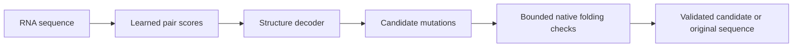

# RNA-StableAI development roadmap — 2026-10-11

Workspace: `/home/zyliu/Documents/rna-stable-ai`.

RNA-StableAI is a working research prototype. The current working roadmap is at
**step 4: independent biological validation**. Engineering functionality and
synthetic experiments are implemented; independent accuracy and biological
stability remain unestablished. These stages describe the evidence needed for
a validated system, rather than a percentage-complete estimate.

## Pipeline

Learned scores rank proposals. LinearFold guides search acceptance, and ViennaRNA
reference checks determine whether a mutated sequence passes the energy-selection
gate. Computational energy selection does not prove biological stability or
retained function. Model prediction and mutation search can also be used as
separate research workflows.

## Stages and current position

| Step | Stage | Evidence and remaining work |
|---:|---|---|
| 1 | Reproducible foundations | Data hashes, CPU folding tools, separate GPU encoder benchmarks, resource limits, durable journals and artifact replay implemented. |
| 2 | Structure-model development | Baseline, adjacent-stack and local-helix models trained. Nine matched fits use 89 training and 47 reused validation records; sampled supervision and decoder controls also implemented. |
| 3 | Model-guided sequence optimization | Frozen synthetic stack and two helix studies complete. Combined comparison retains 54 trajectories and 12 paired prior comparisons; results are mixed. |
| **4** | **Independent biological validation — current** | Metadata/exposure screening implemented. The local Rfam archive contains only exposed families, so no fresh independent evaluation cohort can yet be frozen. |
| 5 | Long biological RNA validation | Synthetic resource demonstrations reach 10,000 nt. Default exact decoding is bounded to 1024 nt; longer decoding is approximate. Suitable longer biological training/evaluation annotations remain pending. |
| 6 | Experimental stability and function | Requires measured stability/function outcomes and an appropriate validation protocol. No biological-stability result is currently established. |
| 7 | Validated release | Package, publish and document a validated model after the required scientific gates are met. Current code is a research prototype; trained checkpoints remain local. |

## What the results mean

On repeatedly reused development records, local-helix pair F1 was
0.5244/0.4951/0.4911 across three model seeds, versus
0.3885/0.3763/0.3933 for the baseline. These results support continued development,
not independent generalization.

Earlier, different pair/context models transferred poorly in family-ID-separated
trials: pair-model F1 was 0.0912 on RF00008 and context-model F1 was 0.0036 on
RF00017. Those tests are now exposed. They do not evaluate the current helix
checkpoint and cannot be reused as fresh tests when improving it.

In synthetic optimization comparisons, helix selected lower native energies than
stack in nine paired comparisons and higher energies in three. Repeated search
and model seeds share inputs. The second helix study retains one interrupted
native request with unknown outcome/cost; it was not retried.

## Immediate next milestone

Freeze an evaluation protocol and model/decoder configuration before running
predictions on new annotated RNA families. First acquire and screen family/source
metadata and sequences, then resolve overlap with training/development exposures,
bind the selected sequences to exact annotations, and save the family plan.
Record test exposure before inference. Preserve every planned outcome, including
failures, and report family-level results alongside folding-tool controls.
Test observations must not tune the evaluated checkpoint or decoder.

The completed local metadata audit checked 3172 known exposure records, of which
3104 lack explicit family IDs. It found 474 FASTA metadata entries: RF00001 (361),
RF00008 (47), RF00017 (22), RF00169 (44). All four families are already exposed;
zero entries qualify as metadata candidates. Some strand IDs identify multiple
processed fragments, which are retained separately using sequence hashes.
Unknown family/clan and legacy tool-training provenance still limits independence
claims even when a new sequence passes the overlap heuristic.

## Evidence

- [Model development review](development_2026-10-06_review.md)
- [Completed native studies](development_2026-10-11_review.md)
- [Family readiness audit](family_readiness_report.md)
- [Earlier pair family trial](family_trial_report.md)
- [Earlier context family trial](context_family_trial_report.md)
