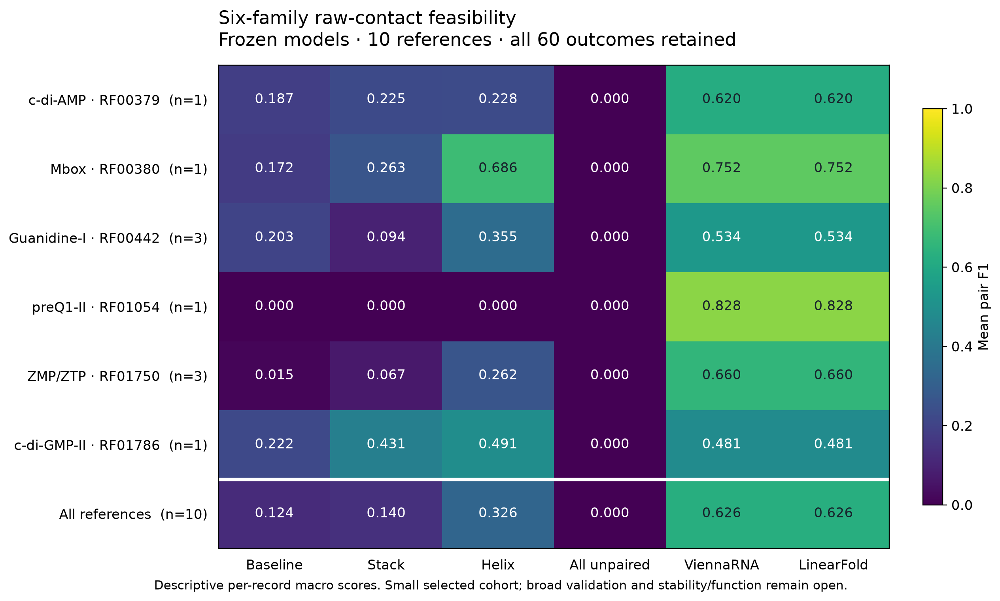

# RNA-StableAI raw-structure feasibility review — 2026-10-14

Workspace: `/home/zyliu/Documents/rna-stable-ai`.
Evaluation: `results/raw_structure_feasibility_runs/20261015T025936.192087Z`.

The separately declared six-family feasibility comparison is complete. All
60 planned predictions are measured; all 20 native requests completed, zero
unknown, with 1.740145475 known native wall seconds. Original seed-20261006
baseline/stack/helix checkpoints, exact top-16 decoder and zero penalty were
frozen before source outcomes. No fitting, calibration or model/default selection.

## Source and coverage

Thirty metadata requests passed family/clan/release verification. Twenty-one
fixed PDB-chain requests were frozen before raw sequence/contact acquisition.
All returned successfully at the transport level; three had unusable sequences.
Of the remaining 18, seven were redundant and one exceeded the final family cap.
Ten selected records retain every returned cWW contact. All 10 pass explicit
returned-PDB/chain and contact nucleotide/coordinate identity checks.

Source family counts: c-di-AMP 1, Mbox 1, guanidine-I 3, preQ1-II 1, ZMP/ZTP 3,
c-di-GMP-II 1. This meets the predeclared minimum of one supported reference in
each of six families. It does **not** meet the broader 12-reference / three
sufficiently represented family validation gate. Source exclusions and selected
prediction denominators remain distinct. No replacement after observing contacts.

The 271 gold cWW contacts include seven noncanonical nucleotide combinations;
nine of ten references have crossing contacts. Scoring retains them all, while
the current decoders/native controls produce nested structures. Raw graphs with
multiple partners would remain unsupported; none was silently projected.
The source is structure-derived computational annotation, not direct probing,
cellular stability or function measurement.

## Results

Descriptive per-record macro pair F1 across the ten selected references:

| Method | Planned / measured | Mean pair F1 |
|---|---:|---:|
| Baseline | 10 / 10 | 0.123592 |
| Stack | 10 / 10 | 0.140203 |
| Helix | 10 / 10 | 0.325531 |
| All unpaired | 10 / 10 | 0.000000 |
| ViennaRNA | 10 / 10 | 0.626116 |
| LinearFold | 10 / 10 | 0.626116 |

The two native tools return identical structures on all ten inputs; matching
results are not independent replication. Means weight each selected reference
equally, so the two three-record families contribute more than singletons.
Per-family values, all raw outputs and request journals remain available. No
p-values, independent confidence intervals or population-level claims are made.



The PNG/SVG exports and figure manifest bind the exact evaluation summary and
driver. Figure export replayed frozen models and retained journals, added zero
native requests, and was visually inspected. Original references, model weights,
decoder defaults and the user's README picture remain intact.

## Input and execution checks

Durable validation source exposure precedes imported contact parsing. A separate
durable `test_started` event precedes model loading, predictions and native calls.
Final prior-exposure checks exclude only the declared source's own records.
Models, inputs, exact identity audit, code, package environment and native runtime
are frozen. Native controls use 37 C, beam 100, 30 seconds and 4 GiB per request.

Resume preserves completed native requests and never retries interrupted unknown
outcomes. Verification recomputes model outputs and exact pair scores from retained
inputs/journals, without new native calls or exposure. Fourteen new evaluator
checks cover ordering, source gates, failures/nulls, runtime/input tampering,
orphan outputs and interrupted-request non-retry. Full suite through evaluator:
**794 passed in 221.33 seconds**. Full regression including checkpoint lineage:
**803 passed in 216.32 seconds**, recorded in
`reports/checkpoint-lineage-full-suite-2026-10-14.log`.

## Provenance finding and next work

The three learned checkpoints use identical frozen train/validation bytes, with
89 training and 47 validation records each. The new metadata-only lineage audit
binds these to their original exposure events. Across each 136-record corpus,
47 records have supplied family IDs, six have conservative whole-PDB family
candidates, and 83 remain without confirmed family assignment. Whole-PDB matches
do not establish sequence/chain-specific family membership. Ten upstream source
test records were already used as project development validation; they are exposed
development data and cannot be called fresh tests.

The next data-development step is an explicitly source-labelled, family/clan-aware
training/validation plan. Keep all completed test/assay/source families excluded
from new model-selection evidence. The present cohort is consumed and cannot
be reused as a new independent test. More broad supported biological references,
long biological RNA validation, causal mutation effects, retained function and
complete legacy tool-training provenance remain open.

## Exact replay commands

```bash
cd /home/zyliu/Documents/rna-stable-ai
.venv/bin/python scripts/plan_raw_structure_panel.py --verify results/raw_structure_panel_metadata_summary.json
.venv/bin/python scripts/prepare_raw_structure_references.py --verify results/raw_structure_references_summary.json
.venv/bin/python scripts/verify_raw_structure_identity.py --verify results/raw_structure_identity_summary.json
.venv/bin/python scripts/evaluate_raw_structure_feasibility.py --verify results/raw_structure_feasibility_summary.json
.venv/bin/python scripts/audit_checkpoint_lineage.py --verify results/checkpoint_lineage_summary.json
```
